# ☁️ The Basics of Google Cloud Compute

> **Ek line mein:** Google ke data center mein apna computer kiraye pe lena, usme website chalana, aur traffic badhe to apne aap bada karna. 🚀

📅 Notes date: 05 November 2026  |  🎓 Certification notes  |  🛠️ Tool: `gcloud` CLI

---

## 🗺️ Poori Journey ek nazar mein

Socho tum **online dukaan** khol rahe ho. Ye steps follow hote hain:

```mermaid
flowchart LR
    A[⚙️ Setup<br/>API ON] --> B[🪣 Bucket<br/>Saman rakho]
    B --> C[🖥️ VM<br/>Dukaan banao]
    C --> D[💾 Disk<br/>Godown jodo]
    D --> E[🔥 Firewall<br/>Darwaza kholo]
    E --> F[📋 Template<br/>Dukaan ka nakshaa]
    F --> G[👥 MIG<br/>Kai dukaan]
    G --> H[❤️ Health Check<br/>Check karo zinda hai?]
    H --> I[📈 Autoscale<br/>Bheed = zyada dukaan]
    I --> J[⚡ CDN<br/>Tez delivery]
    J --> K[🔄 Rolling Update<br/>Bina band kiye naya maal]
```



---

## 1️⃣ Setup: Pehle chaabi lagao 🔑

| Command | Kya hota hai? | Real life example |
|---|---|---|
| `gcloud config get compute/zone` | Abhi kaunsa zone active hai wo dikhata hai | "Mera shop kaunse shehar mein hai?" 📍 |
| `gcloud services enable compute.googleapis.com` | Compute Engine API ON karta hai | Dukaan ki **bijli ka connection** on karna 💡 (iske bina VM nahi banega) |

---

## 2️⃣ Cloud Storage: Saman ka godown 🪣

| Command | Kya hota hai? | Real life example |
|---|---|---|
| `gcloud storage buckets create gs://[BUCKET_NAME]` | Files rakhne ka bucket banata hai | Google Drive ka naya folder 📁 |
| `gcloud storage cp -r [FOLDER_NAME] gs://[BUCKET_NAME]` | Local folder ko bucket mein upload karta hai | Laptop se Drive mein **drag & drop** ⬆️ |

---

## 3️⃣ Compute Engine: Apna computer, Google ke ghar mein 🖥️

| Command | Kya hota hai? | Real life example |
|---|---|---|
| `gcloud compute instances create [INSTANCE_NAME] --machine-type=e2-medium` | Naya **VM (virtual server)** banata hai | Kiraye pe computer lena 🏢 |
| `gcloud compute disks create [DISK_NAME] --size=200GB` | 200GB ki alag hard drive banata hai | Naya **external hard disk** 💽 |
| `gcloud compute instances attach-disk [INSTANCE_NAME] --disk=[DISK_NAME]` | Us disk ko VM se jodta hai | Hard disk ko **USB se plug** karna 🔌 |
| `gcloud compute ssh [INSTANCE_NAME]` | VM ke andar secure login | Dukaan ke **andar ghusna** 🚪 |

> 💡 **Yaad rakho:** VM = computer, Disk = uski storage. VM delete ho jaye to bhi alag disk bacha sakte ho.

---

## 4️⃣ Networking: Darwaza kholo 🔥

| Command | Kya hota hai? | Real life example |
|---|---|---|
| `gcloud compute firewall-rules create [RULE_NAME] --allow tcp:80` | Port 80 (HTTP) khol deta hai taaki log website dekh saken | Dukaan ka **shutter upar** karna, customer aa sakte hain 🛍️ |

> 🔒 By default sab band hota hai. Jo kholna hai wahi kholo, safety ke liye.

---

## 5️⃣ Scaling & Load Balancing: Dukaan ko bada banao 📈

### 📋 Pehle nakshaa banao
```bash
gcloud compute instance-templates create [TEMPLATE_NAME] --source-instance=[VM_NAME]
```
👉 Ek VM ki **copy-paste setting** save ho jati hai. Jaise **Photocopy master** 📄

### 👥 Phir kai copies chalao
```bash
gcloud compute instance-groups managed create [MIG_NAME] --template=[TEMPLATE_NAME]
```
👉 **MIG (Managed Instance Group)** = ek jaisi kai VMs ka ek team. Jaise **ek brand ki 10 branches** 🏬

### ❤️ Check karo sab zinda hain?
```bash
gcloud compute health-checks create http [CHECK_NAME] --port 8080
```
👉 Har kuch second mein VM ko "Hello, theek ho?" bolta hai. Jawab nahi aaya to **doctor bulao** (VM replace) 🩺

### 📈 Bheed ke hisab se apne aap badhao/ghatao
```bash
gcloud compute instance-groups managed set-autoscaling [MIG_NAME] --target-load-balancing-utilization 0.60
```
👉 Load 60% se upar gaya to **aur VMs add**, kam hua to **VMs hata do** (paise bachte hain 💰)

### ⚡ Website ko rocket bana do
```bash
gcloud compute backend-services update [SERVICE_NAME] --enable-cdn
```
👉 **CDN** = website ki copy duniya bhar ke paas ke servers mein. Jaise **Amazon ka local warehouse**, delivery jaldi 📦

### 🔄 Bina band kiye update
```bash
gcloud compute instance-groups managed rolling-action replace [MIG_NAME]
```
👉 Ek-ek karke VMs badalta hai, site **kabhi down nahi hoti** (zero downtime). Jaise **chalti train ke pahiye badalna** 🚆

---

## 🧠 Quick Cheat Sheet

| Mujhe karna hai... | Ye use karo |
|---|---|
| Server chahiye | `instances create` |
| Extra storage chahiye | `disks create` + `attach-disk` |
| Server mein ghusna hai | `compute ssh` |
| Website public karni hai | `firewall-rules create` |
| Same server ki copies | `instance-templates` → `managed create` |
| Traffic ke hisab se scale | `set-autoscaling` |
| Website tez karni hai | `--enable-cdn` |
| Naya code bina downtime | `rolling-action replace` |

---

## ⚠️ Real use mein ye bhi lagega (Pro Tips)

- `instance-templates create` mein zone chahiye hota hai: `--source-instance-zone=[ZONE]`
- `set-autoscaling` mein limit bhi do: `--max-num-replicas=5`
- `[SQUARE_BRACKETS]` ki jagah apna naam daalo. Brackets mat likho.
- Kaam ke baad VMs delete karo, nahi to bill aata rahega 💸

---

⭐ Agar ye notes kaam aaye to repo ko **star** karo!
